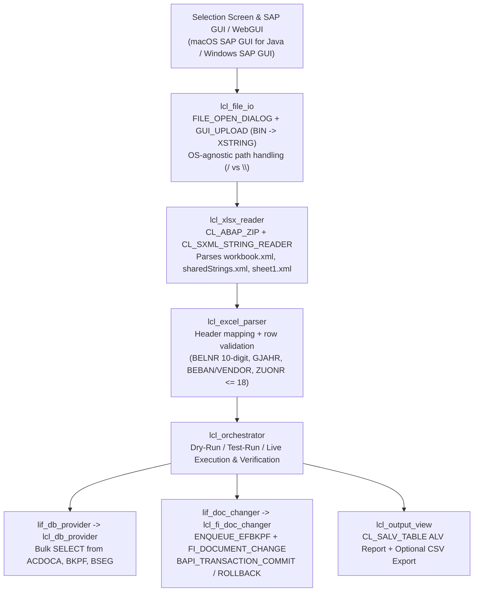

# SAP FI Bulk Assignment (`ZUONR`) Change — ABAP Z-Program Implementation & Test Plan

## 1. Purpose & Scope

Design and implement a standalone, production-grade ABAP executable report **`ZFI_BULK_CHANGE_ASSIGN`** that replaces the external Python scripts ([`change_assignment.py`](change_assignment.py), [`change_assignment_rfc.py`](change_assignment_rfc.py), and [`fetch_acdoca_docs.py`](fetch_acdoca_docs.py)) and runs natively inside SAP S/4HANA (on-premise 2022+).

### Key Goals
1. **Cross-Platform Excel (`.xlsx`) Parsing (macOS & Windows)**:
   - **Zero OLE2 Automation**: Never call `ALSM_EXCEL_TO_INTERNAL_TABLE`, `TEXT_CONVERT_XLS_TO_SAP`, or `KCD_EXCEL_OLE_TO_INT_CONVERT` (which spawn `EXCEL.APPLICATION` via COM/OLE2 and **fail completely on macOS SAP GUI for Java** and WebGUI/Fiori).
   - **Binary Upload + Server-Side OpenXML Parsing**: Upload the `.xlsx` file as raw binary (`FILETYPE = 'BIN'`) via `CL_GUI_FRONTEND_SERVICES=>GUI_UPLOAD` into an `XSTRING`, or read from the Application Server (`OPEN DATASET ... FOR INPUT IN BINARY MODE`), and parse the OpenXML package in memory on the ABAP server using `CL_ABAP_ZIP` and `sXML` (`CL_SXML_STRING_READER`).
2. **100% Business Logic Parity with the Python Scripts**:
   - Parse the same 5 required Excel columns (`Doc Number + Year`, `Source Data`, `G/L Account`, `Account`, `KODE PROJECT`) by header name (case-insensitive, trimmed).
   - Validate row rules (`Doc Number + Year` $\ge 5$ chars $\rightarrow$ 10-digit `BELNR` + 4-digit `GJAHR`; `Source Data` $\in \{\text{BEBAN}, \text{VENDOR}\}$; `KODE PROJECT` non-empty and $\le 18$ chars).
   - Resolve line items against `ACDOCA` (filtered by `RBUKRS`, `RLDNR = '0L'`, and `(BELNR, GJAHR)` pairs) by matching alpha-stripped `RACCT` against the Excel `G/L Account`.
   - Enforce the same status state machine: `PLANNED`, `SKIPPED_ALREADY_SET`, `DOC_NOT_FOUND`, `NO_MATCH`, `AMBIGUOUS`, `TESTRUN_OK`, `CHANGED`, `NOT_CHANGED`, `SEND_ERROR`, and `EXCEL_ERROR`.
   - support `--limit N` (`P_LIMIT`), `--dry-run` (`P_DRYRUN`), and `--testrun` (`P_TESTRN`).
3. **Clean Architecture & High Testability (ABAP Unit)**:
   - Decouple file I/O, OpenXML `.xlsx` parsing, database access (`lif_db_provider`), and document change execution (`lif_doc_changer`) via local interfaces so that every component is deterministic and covered by **ABAP Unit (`FOR TESTING DURATION SHORT RISK LEVEL HARMLESS`)** without modifying database tables or requiring a GUI connection.

---

## 2. Architecture & Component Design

### 2.1 Cross-Platform `.xlsx` Parser (`lcl_xlsx_reader`)

Why custom `CL_ABAP_ZIP` + `sXML` instead of OLE2 or `CL_FDT_XL_SPREADSHEET`?
- **No Frontend OS Dependency**: Works identically when uploaded from **macOS** (SAP GUI for Java / Fiori / WebGUI) or **Windows** (SAP GUI for Windows), or read from an Application Server path (`AL11`).
- **Handles All Excel Cell Encodings Produced by macOS Excel, Windows Excel, and `openpyxl`**:
  1. `t="s"` (Shared String): `<v>` contains the 0-based index into `xl/sharedStrings.xml`. Supports both simple `<si><t>...</t></si>` and rich-text runs `<si><r><t>Part 1</t></r><r><t>Part 2</t></r></si>` (common when edited on macOS/Windows Excel), while ignoring phonetic guides `<rPh>`.
  2. `t="inlineStr"` (Inline String): Text inside `<is><t>...</t></is>`.
  3. `t="str"` (Formula Cached String): Text directly inside `<v>...</v>` (present in `Contoh Data SAP for change Assignment.xlsx`, e.g., cell `Y3`).
  4. `t="n"` or omitted `t` (Numeric / Date Serial): Raw value in `<v>...</v>`.
  5. **Sparse Rows / Empty Cells**: Resolves column index directly from the A1 cell reference (`r="A2"` $\rightarrow$ col 1, `r="I2"` $\rightarrow$ col 9, `r="AA2"` $\rightarrow$ col 27) via `col_letters_to_index( )`, so missing empty `<c>` elements in a row never shift subsequent columns.
  6. **Dynamic First-Sheet Resolution**: Reads `xl/workbook.xml` and `xl/_rels/workbook.xml.rels` to locate the first worksheet's target path (stripping any leading `/`, e.g. `/xl/worksheets/sheet1.xml` $\rightarrow$ `xl/worksheets/sheet1.xml`), falling back to `xl/worksheets/sheet1.xml`.

### 2.2 Cross-Platform File Upload & CSV Download (`lcl_file_io`)

| Concern | Windows (SAP GUI for Windows) | macOS (SAP GUI for Java) | Mitigation in `lcl_file_io` |
|---|---|---|---|
| File Picker (`F4`) | Uses backslashes `C:\path\file.xlsx` | Uses forward slashes `/Users/name/file.xlsx` | Use `CL_GUI_FRONTEND_SERVICES=>FILE_OPEN_DIALOG` & `FILE_SAVE_DIALOG`; never hardcode `\` when splitting paths. |
| Binary Upload | `GUI_UPLOAD` with `FILETYPE = 'BIN'` | `GUI_UPLOAD` with `FILETYPE = 'BIN'` | Reconstruct exact `XSTRING` using `CL_BCS_CONVERT=>SOLIX_TO_XSTRING` with `iv_size = lv_filelength` so trailing null bytes in the last 255-byte `SOLIX` row do not corrupt the ZIP central directory. |
| CSV Export | `GUI_DOWNLOAD` with `FILETYPE = 'ASC'`, `CODEPAGE = '4110'` (UTF-8) | `GUI_DOWNLOAD` with `FILETYPE = 'ASC'`, `CODEPAGE = '4110'` (UTF-8) | RFC-4180 CSV formatting (`doc,year,item,source,old,target,status,message`) matching the Python CSV byte-for-byte. |

---

## 3. Detailed Business Logic Specification

### 3.1 Selection Screen Parameters
- `P_FILE` (`STRING`, obligatory): Local `.xlsx` file path (with `F4` file dialog).
- `P_BUKRS` (`BUKRS`, default `'1000'`, obligatory): Company Code.
- `P_RLDNR` (`FINS_LEDGER`, default `'0L'`, obligatory): Ledger for `ACDOCA` lookup.
- `P_LIMIT` (`I`, default `0`): Process only the first $N$ distinct documents (`0` = all documents).
- `P_DRYRUN` (`ABAP_BOOL` radiobutton, default `'X'`): **Dry Run (Plan Only)** — resolves line items against `ACDOCA`, checks `BSEG` clearing status, makes no database changes.
- `P_TESTRN` (`ABAP_BOOL` radiobutton): **Test Run (Validate Lock & Authority)** — performs all `BKPF`/`BSEG` checks and document locking without calling `FI_DOCUMENT_CHANGE`.
- `P_EXEC` (`ABAP_BOOL` radiobutton): **Live Execution** — updates `ZUONR` via `FI_DOCUMENT_CHANGE`, commits per document, and re-verifies in `ACDOCA`.
- `P_CSV` (`ABAP_BOOL` checkbox) + `P_CSVFIL` (`STRING`): Optional local CSV result export path.

### 3.2 Excel Row Validation (`lcl_excel_parser`)
1. **Header Row (Row 1)**:
   - Map column headers (trimmed, case-insensitive) to column indices:
     - `Doc Number + Year`
     - `Source Data`
     - `G/L Account`
     - `Account`
     - `KODE PROJECT`
   - If any required column is missing, raise fatal exception `lcx_bulk_error` listing the missing columns.
2. **Data Rows (Row 2..N)**:
   - If `Doc Number + Year` is empty/whitespace, skip the row silently.
   - If `strlen( key ) < 5`, log an `EXCEL_ERROR` row (`bad 'Doc Number + Year'`).
   - Split `key`:
     - `year` = last 4 characters (`key+lv_off(4)`), must be 4 digits (`CO '0123456789'`).
     - `doc` = prefix before last 4 characters, padded to 10 characters with leading zeros (`|{ lv_doc_raw ALPHA = IN }|` / `10`-char zero-padded).
   - `Source Data` = trimmed, uppercased: must be `'BEBAN'` or `'VENDOR'`; otherwise record `EXCEL_ERROR`.
   - `KODE PROJECT` = trimmed: must be non-empty and `strlen( target ) <= 18`; otherwise record `EXCEL_ERROR`.
   - Preserve document discovery order (matching Python's `OrderedDict`) and apply `P_LIMIT` to the first $N$ distinct `(doc, year)` pairs.

### 3.3 Database Lookup & Line Resolution (`lcl_db_provider` & `lcl_orchestrator`)
1. **Authorization Check**:
   - Check `F_BKPF_BUK` with `BUKRS = p_bukrs` and `ACTVT = '02'` (Change) for Live/Test run, or `ACTVT = '03'` (Display) for Dry Run.
2. **Bulk `ACDOCA` + `BSEG` Lookup**:
   - Query `ACDOCA` for `RBUKRS = @p_bukrs`, `RLDNR = @p_rldnr`, and `FOR ALL ENTRIES IN @lt_doc_keys` (`BELNR = @lt_doc_keys-doc AND GJAHR = @lt_doc_keys-year`), retrieving `BELNR`, `GJAHR`, `DOCLN`, `RACCT`, `ZUONR`.
   - Query `BSEG` for `AUGBL` (Clearing Document) to flag cleared items.
   - Item number `BUZEI` = last 3 characters of `ACDOCA-DOCLN` (`docln+3(3)`).
3. **Line Matching (`resolve_line`)**:
   - Strip leading zeros from both `ACDOCA-RACCT` and the Excel `G/L Account` (`strip_leading_zeros`).
   - For a given Excel row `(doc, year, gl_account)`:
     - If document `(doc, year)` has no lines in `ACDOCA` $\rightarrow$ status = `DOC_NOT_FOUND`.
     - Filter document lines where `strip0( racct ) = strip0( gl_account )`:
       - `0` hits $\rightarrow$ status = `NO_MATCH`.
       - `> 1` hits $\rightarrow$ status = `AMBIGUOUS`.
       - `1` hit and `line-zuonr = row-target` $\rightarrow$ status = `SKIPPED_ALREADY_SET`.
       - `1` hit and `line-zuonr <> row-target` $\rightarrow$ status = `PLANNED` (if `augbl IS NOT INITIAL`, add warning message `'Cleared item (AUGBL=' && augbl && '); check OB32 if rejected'`).

### 3.4 Document Change & Verification (`lcl_fi_doc_changer`)
- Group all `PLANNED` rows by `(doc, year)`.
- Process one document per LUW (all-or-nothing per document, matching [`zrfc_fi_change_assign.abap`](zrfc_fi_change_assign.abap)):
  1. Lock document via `CALL FUNCTION 'ENQUEUE_EFBKPF'` (`BELNR`, `BUKRS`, `GJAHR`). If locked by another user, mark document lines `SEND_ERROR` with lock message and continue to next document.
  2. In `P_TESTRN = 'X'` mode: unlock via `DEQUEUE_EFBKPF` and mark lines `TESTRUN_OK`.
  3. In `P_EXEC = 'X'` mode:
     - Sort items so `BEBAN` (G/L) lines come first, followed by `VENDOR` lines.
     - For each line in the document, build `LT_ACCCHG` (`FDNAME = 'ZUONR'`, `OLDVAL = line-old`, `NEWVAL = line-target`) and call `FI_DOCUMENT_CHANGE` (`I_BUKRS`, `I_BELNR`, `I_GJAHR`, `I_BUZEI`).
     - If any line in the document returns `sy-subrc <> 0`:
       - Format the system message (`MESSAGE ID sy-msgid ... INTO lv_msg`).
       - Execute `BAPI_TRANSACTION_ROLLBACK`.
       - Unlock document (`DEQUEUE_EFBKPF`).
       - Mark all lines of that document `SEND_ERROR` with `lv_msg`.
     - If all lines in the document succeed:
       - Execute `BAPI_TRANSACTION_COMMIT` with `WAIT = 'X'`.
       - Unlock document (`DEQUEUE_EFBKPF`).
       - Mark lines `SENT`.
  4. **Post-Commit Verification**:
     - Re-query `ACDOCA` (`BYPASSING BUFFER`) for all `SENT` documents.
     - Compare current `ZUONR` with `target`: set final status to `CHANGED` if equal, or `NOT_CHANGED` with diagnostic message if different.

---

## 4. Quality & Testing Strategy (ABAP Unit + Cross-Platform Verification)

### 4.1 Built-in ABAP Unit Test Suite (`FOR TESTING`)
The report includes self-contained local test classes executable via `Ctrl+Shift+F10` in SE38 / Eclipse ADT with **zero database or GUI dependencies**:

| Test Class | Test Cases | What It Verifies |
|---|---|---|
| `ltcl_xlsx_reader_test` | `test_col_letters_to_index` `test_parse_in_memory_xlsx` `test_rich_text_and_inline_str` `test_leading_slash_sheet_path` | Builds a real `.xlsx` ZIP archive in memory using `CL_ABAP_ZIP` (containing `[Content_Types].xml`, `xl/workbook.xml`, `xl/_rels/workbook.xml.rels`, `xl/sharedStrings.xml`, and `xl/worksheets/sheet1.xml`), feeds the `XSTRING` to `lcl_xlsx_reader=>parse( )`, and asserts exact cell extraction across shared strings (`t="s"`), rich-text runs (`<r><t>`), inline strings (`t="inlineStr"`), formula strings (`t="str"`), numeric cells, and sparse columns (`A`, `F`, `I`, `Y`, `AA`). |
| `ltcl_excel_parser_test` | `test_valid_rows_and_padding` `test_missing_columns_raises` `test_invalid_rows_logged` `test_doc_limit_preserves_order` | Verifies 10-digit `BELNR` zero-padding (`1000041372019` $\rightarrow$ `0100004137` / `2019`), `BEBAN`/`VENDOR` validation, 18-char `KODE PROJECT` limit, blank-row skipping, error collection, and `--limit N` document slicing. |
| `ltcl_orchestrator_test` | `test_line_resolution_states` `test_dry_run_no_changer_call` `test_live_exec_and_verify` `test_doc_rollback_on_error` `test_csv_formatting` | Uses test doubles (`ltd_mock_db`, `ltd_mock_changer`) implementing `lif_db_provider` and `lif_doc_changer` to verify all status transitions (`PLANNED`, `SKIPPED_ALREADY_SET`, `DOC_NOT_FOUND`, `NO_MATCH`, `AMBIGUOUS`, `CHANGED`, `NOT_CHANGED`, `SEND_ERROR`) and RFC-4180 CSV export output. |

### 4.2 SAP Code Inspector (SCI) & Transport Readiness Checklist
- **No obsolete statements**: No `TABLES`, no header-line internal tables, no `OCCURS`, no `FORM`/`PERFORM` (100% ABAP Objects local classes + clean report events).
- **Memory & Binary Safety**: `SOLIX_TO_XSTRING` respects exact byte count `iv_size` from `GUI_UPLOAD`, preventing corrupted ZIP trailers on macOS and Windows.
- **SQL Performance**: Single bulk `SELECT ... FOR ALL ENTRIES` against `ACDOCA` and `BSEG` (after checking table non-emptiness and deduplicating keys), zero `SELECT` statements inside loops.
- **LUW & Lock Hygiene**: Explicit `ENQUEUE_EFBKPF` / `DEQUEUE_EFBKPF` and `BAPI_TRANSACTION_COMMIT( WAIT = 'X' )` / `BAPI_TRANSACTION_ROLLBACK` per document.
- **Safety Dialog in Live Mode**: Confirmation popup (`POPUP_TO_CONFIRM`) before modifying FI documents in live execution mode (`P_EXEC = 'X'`).

---

## 5. Deliverables & File Layout

| File | Description |
|---|---|
| [`ABAP_ZPROGRAM_PLAN.md`](ABAP_ZPROGRAM_PLAN.md) | Architectural plan, cross-platform `.xlsx` specification, business logic contract, and ABAP Unit test plan. |
| [`zfi_bulk_change_assign.abap`](zfi_bulk_change_assign.abap) | Complete ABAP Z-Program (`ZFI_BULK_CHANGE_ASSIGN`) with cross-platform `.xlsx` parser, `ACDOCA` resolution engine, `FI_DOCUMENT_CHANGE` updater, ALV + CSV output, and embedded ABAP Unit test suite. |
| [`test_abap_xlsx_logic.py`](test_abap_xlsx_logic.py) | Automated verification test suite simulating the exact `lcl_xlsx_reader` state machine and `lcl_excel_parser` rules against `Contoh Data SAP for change Assignment.xlsx` and synthetic macOS/Windows `.xlsx` edge cases. |
