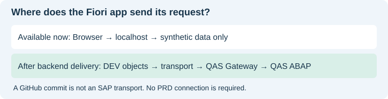
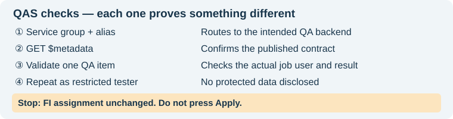

# Your first QAS OData V4 connection — FI assignment upload

**Yes, you can have a real endpoint in QAS without touching PRD.** Here “real” means the browser talks to an ABAP provider, not the Python demo. A **service definition** describes what the app may request. A **service binding** connects that definition to OData V4. **Publishing** makes the service group reachable on a particular Gateway. **Deploying the UI** makes the browser app available; it is a separate step. [SAP: service binding & on-premise transport](https://help.sap.com/docs/abap-cloud/abap-rap/service-binding) · [SAP: Gateway publishing](https://help.sap.com/docs/r/68bf513362174d54b58cddec28794093/latest/en-US/54dcfc66cece463e9e25bc17cf5117b9.html).

## A. What you can do today — no SAP access required

1. Open [the branch](https://github.com/yudhiwidyatama/sapbulkchange/tree/fiori-astra2). Check the branch selector says **fiori-astra2**. Choose **Code → Download ZIP**, extract it, then open a terminal in the **inner `fiori-astra2` folder** containing `webapp`, `backend` and `test`.
2. With Python **3.12** available, run `python -m pip install openpyxl==3.1.5 defusedxml==0.7.1`, then `python test/demo_server.py`. On Windows you can substitute `py -3.12` for `python`. Keep that terminal open. Open **http://127.0.0.1:8080/** in a browser. This needs internet access to load SAPUI5 but **does not log in to SAP**. Use invented data only. [Project instructions](../../README.md)
3. Click **Download Excel template**. Leave its headers unchanged. Enter this single row, left to right, then save as `.xlsx`:

   | Document Number | Fiscal Year | Line Item | Document Type | Posting Date | G/L Account | KODE PROJECT | Source Data |
   |---|---|---|---|---|---|---|---|
   | 42 | 2022 | 1 | SA | 20220131 | 4000 | NEW | BEBAN |

4. Choose company **DEMO**, select your file and click **Validate workbook**. Click **Refresh status** until **READY**. Expected: Excel row **2**, key **0000000042 / 2022 / 001**, **OLD → NEW**, **PLANNED**. **Apply Changes must remain disabled.** To exercise an error, repeat the row in Excel, save, select it again and validate; download the duplicate errors. Stop the local server with **Ctrl+C**. [Test fixture and limitations](../../README.md)

## B. Prepare for QAS — your next manual task

5. Ask **Basis** for your DEV and QAS system IDs and clients, QAS HTTPS Gateway URL, whether Gateway is **embedded** (same system) or **hub** (separate front end), the alias routing to QAS, transport route and QAS tester account. Ask **FI Security** for a permitted and a restricted QA test case, and **FI** for designated non-production documents. Do not send passwords, tokens or workbook contents in the ticket.
6. Ask the **ABAP developer**: “Are the active service definition, V4 UI service binding, run/row projections, authorization handlers and requester-bound validation worker ready, and what are their transport and service-group IDs?” **Stop here if the answer is no.** In this branch the [metadata XML](../../test/metadata.xml) is a test contract; the [staging sources](../../backend) are not an executable OData provider. Do not import the XML as a service, publish the staging table directly, or use a shared FI writer to make the test pass. [Current delivery status](../../README.md)

## C. Once the developer supplies the real provider — DEV → QAS

7. **ABAP developer, DEV:** In Eclipse with ABAP Development Tools (ADT), open the DEV ABAP project and transportable package. Activate the application objects and service definition. Right-click the package → **New → Other ABAP Repository Object** → search **Service Binding**. Enter the agreed name and description, choose **OData V4 – UI**, select the active service definition, assign the Workbench request, finish and activate. If the binding was delivered already, open it; do **not** create a duplicate. Select its service version to inspect the entity sets and URL. [SAP: binding editor](https://help.sap.com/docs/abap-cloud/abap-development-tools-user-guide/using-service-binding-editor-for-odata-v4-service?locale=en-US)
8. **Developer + Basis:** ADT **Publish** is for a **local DEV test**, not a deployment to QAS. If locally published for testing, coordinate **Unpublish in DEV** before switching to Gateway-managed activation, as SAP describes for on-premise systems. Release/import the transportable repository objects and dependencies through your normal DEV → QAS route. Basis should use the landscape's approved transport or target-side procedure for Gateway publication. **Do not open QAS for development or change client settings for this guide.** If QAS is an explicitly approved development sandbox rather than a managed quality system, confirm the creation route with Basis first. [SAP: Service Transport](https://help.sap.com/docs/abap-cloud/abap-rap/service-binding)
9. **Basis, QAS Gateway client:** In SAP GUI enter `/n/IWFND/V4_ADMIN`. Check whether the expected group is already published with the correct alias. If not, and local publication is authorized: **Publish Service Groups → choose the QAS system alias → Get Service Groups → select the exact group → Publish Service Groups → confirm**. Record any requested customizing transport per policy. Do not assume the alias is `LOCAL`, especially on a hub. Do not publish every group or use the V2 maintenance transaction. [SAP: Publish a Service Group](https://help.sap.com/docs/SAP_NETWEAVER_750/68bf513362174d54b58cddec28794093/97abd231f89a40169aaaad017439531e.html)

10. **Basis + tester, read-only smoke test:** Copy the **actual QAS service root** from Gateway. Sign in with your named QA account. Open `<QAS service root>/$metadata` (one slash before `$metadata`). Expect HTTP **200** and XML, not an HTML login page. Compare the published contract with [the client contract](../../test/metadata.xml): `Runs`, `CompanyCodes`, `Rows` navigation and workbook stream. Then GET `<QAS service root>/CompanyCodes` and verify the returned scope with Security. Metadata success proves the endpoint is reachable, **not** that upload, jobs or FI authorization work. [SAP: service URL and preview](https://help.sap.com/docs/abap-cloud/abap-development-tools-user-guide/using-service-binding-editor-for-odata-v4-service?locale=en-US)
11. **Fiori developer/admin:** Compare the observed service-root **path** with `sap.app → dataSources → mainService → uri` in [manifest.json](../../webapp/manifest.json). Resolve any mismatch in DEV and transport it; do not hard-code a QAS host or password. Have the administrator deploy the **custom upload UI** to the approved QA front end and give you its launch URL or launchpad entry. ADT's generic entity preview is **not** this upload page. Exact app deployment tool, catalog and role names depend on your landscape and are **unverified**. [SAP: ADT preview](https://help.sap.com/docs/abap-cloud/abap-development-tools-user-guide/using-service-binding-editor-for-odata-v4-service?locale=en-US)
12. **Tester + FI Security, validate only:** Use a QA-approved company/document, not `DEMO` or the mock row. Capture the old assignment; upload **one** row; validate, refresh and record run ID, timestamp, final state and requester. Ask Basis to verify **actual job-step user/client = requester/client**. Verify the assignment did not change. Repeat with the restricted tester: no protected old value in preview or export and no access to the first tester's run. Keep **Apply disabled server-side**; do not test posting. An FI policy or identity that cannot be verified is a stop condition. The 20 MiB / 50,000-row load test comes only after this small test passes. [Approved design](../../../FIORI_APP_SPEC.md) · [Authorization and acceptance criteria](../../../FIORI_AUTHORIZATION.md)

### If you get stuck

| What you see | First check / who owns it |
|---|---|
| No service definition or binding in ADT | Developer: confirm package, DEV project and delivered artifacts. Nothing in QAS can publish a missing provider. |
| No matching group | Basis: distinguish already-published from unpublished groups; verify QAS client, backend transport and alias. Do not create a second group. |
| `$metadata` gives 404 | Basis: compare exact host, client, published group, service version and URL. |
| 401/403 or login page | Basis/Security: confirm QAS login and service-start permission. Do not broaden FI roles solely to make metadata load. |
| Metadata works, upload fails or run stays queued | Developer: check upload handler; Basis: check job scheduling, actual job-step user, client and job log against the run ID. Do not retry Apply. |
| Metadata works, but no launchpad tile | Fiori admin: check UI deployment, target mapping and assigned catalog/role separately from the service. |

**Handoff evidence:** QAS SID/client · Gateway alias · transport and service-group IDs · actual service root · metadata HTTP status · run ID · requester vs. job identity · permitted/restricted results · unchanged FI assignment. Record these in your internal QA ticket, not the GitHub repository.
